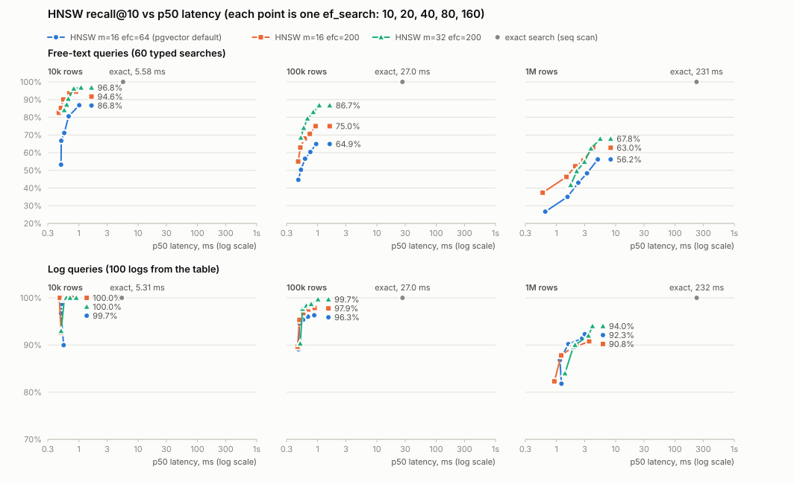

# Semantic search over logs

> Can you find "the server ran out of RAM" in a log table where every message says `java.lang.OutOfMemoryError`? With `LIKE`, no. With full-text, barely. With embeddings, yes, but approximate indexes lose part of the answer at 1M rows, and the loss is measurable.

This chapter adds a `GET /search/logs` endpoint over the `logs` table and measures four ways to answer a typed search: `LIKE`, PostgreSQL full-text search, vector search with [pgvector](https://github.com/pgvector/pgvector) (exact and HNSW), and a hybrid of full-text + vectors. Every number below comes from `pnpm eval:search` and is regenerated by `pnpm eval:report`.

---

## The problem

On-call engineers search logs with words that are not in the logs. Someone types "customers cannot pay, card processor is down" while the logs say `Stripe API request failed: upstream returned 503`. Substring matching finds nothing, and full-text search finds only messages that share a stem with the query.

Embeddings map text to points where similar meanings are close. That fixes paraphrases, but it adds three costs:

1. **Recall.** An approximate index (HNSW) may skip true nearest neighbours.
2. **Exact terms.** Vectors are weak on codes such as `ECONNRESET` or `x509`.
3. **Operations.** Embeddings must be computed for every row, and HNSW builds are slow at scale.

## Setup

| piece | choice | why |
|---|---|---|
| data | `logs` table, synthetic and deterministic (`pnpm seed:logs`, Faker seed 42), 10k / 100k / 1M rows | same rows on every machine, so results are reproducible |
| labels | each seeded error log has a `root_cause` (e.g. `out_of_memory`, `tls_certificate`) | lets us measure precision without hand-labelling results; never returned by the API |
| model | `Xenova/all-MiniLM-L6-v2`, 384 dimensions, ONNX on CPU (`pnpm model:fetch`) | small, local, no API key; ~1.6 ms to embed a query |
| storage | `embedding vector(384)`, cosine distance (`<=>`) | the model's vectors are normalized |
| full-text | GIN on `to_tsvector('english', message)`, OR of the query's lexemes, ranked by `ts_rank_cd` | the classic baseline |
| hybrid | Reciprocal Rank Fusion of 40 full-text + 40 HNSW candidates, `k = 60`, in one SQL statement | no score calibration needed |

## Method

Two query sets, two metrics.

- **Log queries** (`evals/ground_truth*.json`): 100 rows sampled from the table and used as queries. Their exact top-10 neighbours are computed by a sequential scan and cross-checked against a brute-force float64 computation in JS.
- **Free-text queries** (`evals/text_queries.json`): 60 typed searches, 4 per root cause, of three kinds: `keyword` (the log's own words), `mixed`, and `paraphrase` (no words in common).
- **recall@10**: the share of the exact top-10 that a method returns. Ties at the 10th distance count as hits.
- **precision@10**: the share of returned logs whose `root_cause` matches the query's. This is what a user feels.

Latency is client-side wall time over a local socket, with a warm cache and after a warm-up round. pgvector assigns HNSW levels at random, so builds of the same config differ. Up to 100k rows each config was built 3 times, and recall shows the mean and the (min–max) range. At 1M each config was built once.



## Results

<!-- results:start (generated by pnpm eval:report, do not edit) -->

Measured on this machine (4 vCPU, PostgreSQL 17 + pgvector 0.8.1, warm cache, client-side wall time over a local socket). Recall is tie-aware recall@10 against exact search; precision@10 is the share of the 10 results with the expected root cause. Where builds were repeated, recall shows the mean and the (min–max) across builds.

### HNSW build cost

| rows | table heap | GIN | HNSW m=16 efc=64 | HNSW m=16 efc=200 | HNSW m=32 efc=200 |
| :--- | ---: | ---: | ---: | ---: | ---: |
| 10k | 27.8 MB | 1.3 MB | 0.5 s, 16.1 MB | 1.0 s, 16.1 MB | 2.0 s, 16.6 MB |
| 100k | 198 MB | 14.5 MB | 7.3 s, 146 MB | 13.0 s, 146 MB | 20.6 s, 149 MB |
| 1M | 1964 MB | 98.0 MB | 4.2 min, 1387 MB | 25.0 min, 1382 MB | 77.5 min, 1401 MB |

### Free-text queries (60 typed searches, `evals/text_queries.json`)

**10k rows** (3 builds per config, 3 measured rounds)

| method | recall@10 | precision@10 | p50 ms | p95 ms |
| :--- | ---: | ---: | ---: | ---: |
| LIKE `%…%` (no index) | 14.5% | 35.0% | 8.09 | 9.13 |
| full-text (GIN) | 25.3% | 80.0% | 3.51 | 12.6 |
| vector, exact (seq scan) | 100.0% | 92.0% | 5.60 | 6.25 |
| HNSW m=16 efc=64, ef_search=40 | 78.7% (77–83) | 73.2% | 0.47 | 0.61 |
| HNSW m=16 efc=64, ef_search=160 | 90.9% (88–93) | 85.1% | 0.71 | 1.01 |
| HNSW m=16 efc=200, ef_search=40 | 89.7% (85–95) | 82.1% | 0.47 | 0.64 |
| HNSW m=16 efc=200, ef_search=160 | 94.7% (93–98) | 87.0% | 0.76 | 1.02 |
| HNSW m=32 efc=200, ef_search=40 | 92.3% (90–94) | 85.4% | 0.54 | 0.74 |
| HNSW m=32 efc=200, ef_search=160 | 96.7% (97–97) | 88.7% | 0.98 | 1.40 |
| hybrid RRF (full-text + HNSW) | 54.6% (53–56) | 87.6% | 4.47 | 14.2 |

**100k rows** (3 builds per config, 3 measured rounds)

| method | recall@10 | precision@10 | p50 ms | p95 ms |
| :--- | ---: | ---: | ---: | ---: |
| LIKE `%…%` (no index) | 8.5% | 35.0% | 74.1 | 80.2 |
| full-text (GIN) | 10.7% | 80.5% | 26.9 | 118 |
| vector, exact (seq scan) | 100.0% | 92.5% | 27.0 | 29.3 |
| HNSW m=16 efc=64, ef_search=40 | 56.6% (55–59) | 64.1% | 0.62 | 0.91 |
| HNSW m=16 efc=64, ef_search=160 | 64.9% (63–66) | 69.1% | 0.95 | 1.72 |
| HNSW m=16 efc=200, ef_search=40 | 68.0% (61–76) | 67.7% | 0.61 | 0.92 |
| HNSW m=16 efc=200, ef_search=160 | 75.0% (73–77) | 71.3% | 0.93 | 1.64 |
| HNSW m=32 efc=200, ef_search=40 | 79.3% (77–83) | 77.6% | 0.68 | 1.13 |
| HNSW m=32 efc=200, ef_search=160 | 86.7% (83–92) | 81.8% | 1.07 | 2.07 |
| hybrid RRF (full-text + HNSW) | 43.1% (42–44) | 80.5% | 27.0 | 115 |

**1M rows** (1 build per config, 1 measured round)

| method | recall@10 | precision@10 | p50 ms | p95 ms |
| :--- | ---: | ---: | ---: | ---: |
| LIKE `%…%` (no index) | 8.3% | 35.0% | 809 | 865 |
| full-text (GIN) | 10.3% | 80.5% | 123 | 490 |
| vector, exact (seq scan) | 100.0% | 91.7% | 220 | 226 |
| HNSW m=16 efc=64, ef_search=40 | 40.8% | 73.2% | 0.88 | 1.09 |
| HNSW m=16 efc=64, ef_search=160 | 53.7% | 78.2% | 1.57 | 2.23 |
| HNSW m=16 efc=200, ef_search=40 | 49.3% | 70.0% | 0.82 | 1.02 |
| HNSW m=16 efc=200, ef_search=160 | 60.5% | 70.0% | 1.58 | 2.37 |
| HNSW m=32 efc=200, ef_search=40 | 53.2% | 65.5% | 1.10 | 1.61 |
| HNSW m=32 efc=200, ef_search=160 | 63.7% | 72.2% | 1.88 | 4.48 |
| hybrid RRF (full-text + HNSW) | 34.3% | 74.3% | 124 | 487 |

### Log queries (100 logs sampled from the table, `evals/ground_truth*.json`)

**10k rows** (3 builds per config, 3 measured rounds)

| method | recall@10 | precision@10 | p50 ms | p95 ms |
| :--- | ---: | ---: | ---: | ---: |
| LIKE `%…%` (no index) | 19.2% | 87.4% | 1.17 | 8.26 |
| full-text (GIN) | 28.9% | 100.0% | 22.5 | 176 |
| vector, exact (seq scan) | 100.0% | 99.5% | 5.63 | 6.31 |
| HNSW m=16 efc=64, ef_search=40 | 99.5% (98–100) | 99.0% | 0.41 | 0.51 |
| HNSW m=16 efc=64, ef_search=160 | 100.0% (100–100) | 99.5% | 0.63 | 0.84 |
| HNSW m=16 efc=200, ef_search=40 | 100.0% (100–100) | 99.5% | 0.44 | 0.55 |
| HNSW m=16 efc=200, ef_search=160 | 100.0% (100–100) | 99.5% | 0.66 | 0.84 |
| HNSW m=32 efc=200, ef_search=40 | 100.0% (100–100) | 99.5% | 0.48 | 0.62 |
| HNSW m=32 efc=200, ef_search=160 | 100.0% (100–100) | 99.5% | 0.78 | 1.10 |
| hybrid RRF (full-text + HNSW) | 56.2% (56–56) | 99.3% | 24.2 | 174 |

**100k rows** (3 builds per config, 3 measured rounds)

| method | recall@10 | precision@10 | p50 ms | p95 ms |
| :--- | ---: | ---: | ---: | ---: |
| LIKE `%…%` (no index) | 16.4% | 90.6% | 1.45 | 74.9 |
| full-text (GIN) | 26.3% | 100.0% | 442 | 1,727 |
| vector, exact (seq scan) | 100.0% | 100.0% | 27.0 | 28.3 |
| HNSW m=16 efc=64, ef_search=40 | 95.4% (92–98) | 99.1% | 0.57 | 0.77 |
| HNSW m=16 efc=64, ef_search=160 | 96.3% (93–99) | 99.5% | 0.88 | 1.41 |
| HNSW m=16 efc=200, ef_search=40 | 96.8% (96–98) | 99.7% | 0.58 | 0.80 |
| HNSW m=16 efc=200, ef_search=160 | 97.9% (97–100) | 100.0% | 0.89 | 1.42 |
| HNSW m=32 efc=200, ef_search=40 | 98.3% (98–99) | 99.3% | 0.65 | 0.94 |
| HNSW m=32 efc=200, ef_search=160 | 99.7% (99–100) | 100.0% | 1.02 | 1.68 |
| hybrid RRF (full-text + HNSW) | 57.5% (57–58) | 99.7% | 415 | 1,637 |

**1M rows** (1 build per config, 1 measured round)

| method | recall@10 | precision@10 | p50 ms | p95 ms |
| :--- | ---: | ---: | ---: | ---: |
| LIKE `%…%` (no index) | 16.3% | 94.0% | 1.53 | 798 |
| full-text (GIN) | 32.6% | 100.0% | 1,023 | 6,358 |
| vector, exact (seq scan) | 100.0% | 100.0% | 222 | 225 |
| HNSW m=16 efc=64, ef_search=40 | 91.7% | 100.0% | 0.66 | 1.03 |
| HNSW m=16 efc=64, ef_search=160 | 93.4% | 100.0% | 1.19 | 2.31 |
| HNSW m=16 efc=200, ef_search=40 | 91.1% | 99.0% | 0.65 | 1.05 |
| HNSW m=16 efc=200, ef_search=160 | 93.3% | 100.0% | 1.33 | 2.46 |
| HNSW m=32 efc=200, ef_search=40 | 88.9% | 97.0% | 0.83 | 1.56 |
| HNSW m=32 efc=200, ef_search=160 | 93.0% | 98.0% | 1.48 | 3.35 |
| hybrid RRF (full-text + HNSW) | 62.4% | 99.0% | 1,022 | 6,497 |

### Free-text precision@10 by kind of query

| rows | kind | LIKE | full-text | vector exact | HNSW m=32 efc=200 ef=40 | hybrid |
| :--- | :--- | ---: | ---: | ---: | ---: | ---: |
| 10k | keyword | 83.3% | 91.3% | 91.3% | 81.8% | 88.6% |
| 10k | mixed | 5.3% | 94.2% | 99.5% | 92.5% | 95.4% |
| 10k | paraphrase | 0.0% | 48.2% | 84.7% | 82.7% | 77.5% |
| 100k | keyword | 83.3% | 91.3% | 91.7% | 74.2% | 84.9% |
| 100k | mixed | 5.3% | 94.2% | 97.9% | 82.6% | 88.8% |
| 100k | paraphrase | 0.0% | 50.0% | 87.6% | 76.9% | 65.1% |
| 1M | keyword | 83.3% | 91.3% | 91.7% | 54.2% | 74.6% |
| 1M | mixed | 5.3% | 94.2% | 95.3% | 78.9% | 86.8% |
| 1M | paraphrase | 0.0% | 50.0% | 87.6% | 66.5% | 60.0% |

### Free-text queries where a method returns nothing relevant (precision@10 = 0, of 60)

| rows | LIKE | full-text | vector exact | HNSW m=32 efc=200 ef=40 | HNSW m=32 efc=200 ef=160 | hybrid |
| :--- | ---: | ---: | ---: | ---: | ---: | ---: |
| 10k | 39 | 7 | 4 | 5 | 4 | 2 |
| 100k | 39 | 7 | 4 | 6 | 4 | 2 |
| 1M | 39 | 7 | 4 | 20 | 16 | 3 |

### Larger ef_search, 1M rows, HNSW m=16 efc=64 (`evals/results/search-1m-ef.json`, a separate build)

| ef_search | free-text recall@10 | free-text precision@10 | p50 ms | p95 ms | log-query recall@10 |
| ---: | ---: | ---: | ---: | ---: | ---: |
| 40 | 34.5% | 60.5% | 2.64 | 3.09 | 91.6% |
| 160 | 52.2% | 65.3% | 1.69 | 2.86 | 93.7% |
| 320 | 52.5% | 67.0% | 2.44 | 4.45 | 95.8% |
| 640 | 59.7% | 72.0% | 4.04 | 7.15 | 95.8% |
| 1000 | 62.8% | 73.7% | 6.39 | 12.2 | 95.8% |

Embedding a typed query with the local model adds ~1.65 ms (p50) before any vector search.

<!-- results:end -->

## Findings

**1. Keywords and meaning fail in opposite places.**
- `LIKE` finds nothing for 39 of the 60 typed queries: any paraphrase, and any multi-word query whose words aren't adjacent in the log.
- Full-text reaches 80% precision. It still scores 0 on paraphrases that share no stem with the logs ("server ran out of RAM"), and on tokenizer surprises: `NullPointerException` doesn't match the token `java.lang.nullpointerexception`, and "too many requests" loses "too" and "many" as stopwords.
- Vectors score 0% on bare codes such as `ECONNRESET` and `x509`, where full-text scores 100%. A code means nothing to a sentence-embedding model.

**2. Exact vector search is the quality ceiling, and its cost grows with the table.** Precision stays at ~92% at every size, but p50 goes from 5.6 ms (10k) to 27 ms (100k) to 220 ms (1M): a full scan, row by row.

**3. HNSW recall depends on what you ask it, so the eval set matters.**
- *Log queries* are rows from the table, so they sit where the data is. HNSW finds 93–100% of their exact neighbours at ef_search 160.
- *Typed queries* are out of distribution: their nearest log is at cosine distance 0.4–0.7. Here recall falls from 97% at 10k to 64% at 1M (m=32, ef_construction=200, ef_search=160).
- At 1M, 16 of the 60 typed queries come back with no relevant log at all, against 4 for exact search. The greedy graph walk ends in the wrong region.
- An eval built only from rows of the table, the easy thing to build, would have reported 93% and hidden this.

**4. Build parameters matter more than ef_search, until the build itself becomes the problem.**
- At 100k, m=32/ef_construction=200 at ef_search 40 (79%) beats the default 16/64 at ef_search 160 (65%).
- At 1M, ef_search 1000 on the default index (62.8%, 6.4 ms) catches up with m=32/200 at ef_search 160 (63.7%, 1.9 ms). Query-time effort can buy back recall, at about 3x the latency.
- The bigger graph is expensive to build: 77 min at 1M, against 4–10 min for the default.

**5. Recall against exact search is not relevance.** At 1M, m=32/200 at ef_search 160 has higher recall than 16/64 (63.7% vs 53.7%) but lower precision (72.2% vs 78.2%). Missing a true neighbour doesn't always mean missing a relevant log, and each config was built only once at 1M. Both metrics are reported for this reason.

**6. Measure the noise before reading the differences.**
- Two builds of the same config differ by up to 10 recall points at 10k: 85–95% for 16/200 at ef_search 40.
- The first ef_search measured after a fresh build pays for warming the cache. That causes the backwards segments in the chart: ef_search 10 at 10k, and ef_search 40 in the 1M sweep (2.6 ms, slower than 160).

**7. Hybrid is the safest mode, not the best on average.**
- Exact vectors have the best mean precision.
- Hybrid fails least: 2–3 of 60 typed queries come back with nothing relevant, against 7 for full-text and 16–20 for HNSW at 1M.
- It pays for its full-text side: 124 ms p50 at 1M for typed queries, and over a second for long log-text queries, whose OR of many lexemes matches a large share of the table.

**8. Embedding the query costs ~1.6 ms** on CPU. That is less than every search at 1M except HNSW, so the model isn't the bottleneck.

## Conclusion

**The production index is m = 32, ef_construction = 200** (migration `20261115130000_add_logs_embedding_hnsw_index.ts`). It had the best typed-query recall at every size, and builds in seconds up to 100k rows. Since migration `20261118120000` it is a partial index without INFO logs, with the same parameters: see [A partial HNSW index without INFO logs](#a-partial-hnsw-index-without-info-logs).

**The default ef_search is 160.**
- **Why not lower:** going from 40 to 160 adds 4 (10k), 7 (100k) and 10 (1M) recall points and costs less than a millisecond. At 1M, ef_search 160 is 1.9 ms p50 and 4.5 ms p95. That is about the cost of embedding the query (1.6 ms) and far below hybrid's full-text side (124 ms). ef_search is not where the time goes.
- **Why not higher by default:** past 160, recall keeps rising at 1M, but slowly. On the default index, 160 → 1000 adds 10 points for 4x the latency. So the endpoint accepts `ef_search` up to 1000 per request ("dig deeper"), and the default stays at 160.

**The default mode is hybrid.** It is the only mode without a blind spot: codes come from the full-text side, paraphrases from the vector side, and almost no query comes back empty-handed.

**The architectural conclusion: an ANN index is not free recall.**
- At 1M rows, typed queries lose ~20 precision points with HNSW against exact search (72% vs 92%).
- For an internal on-call tool with a few searches a minute, exact search at ~220 ms is a legitimate answer.
- Narrowing first is better still: a service or time window makes exact search over the remaining rows cheap. Phase 5 measures this ([evals/plans/README.md](evals/plans/README.md), experiments 16–20).
- When the index must be rebuilt often (a new embedding model means re-embedding and rebuilding), the default m = 16 / ef_construction = 64 with a larger ef_search gets close to the same recall for 3x the query latency and a fraction of the build time.

## One embedding per log template

Logs are not free text. Almost every message is a fixed sentence with a few values filled in: `Connection to redis-cache-03 timed out after 5000ms` and `Connection to redis-cache-01 timed out after 3000ms` say the same thing. A table of 1M logs has 1M vectors but only a few dozen distinct meanings. `mode=template` searches the meanings instead of the rows.

### How it works

1. **Mask the obvious values** (`src/logs/template.ts`, `toTemplate`). Regexes replace numbers, ids, IPs, hosts, durations, paths and quoted strings with placeholders, on the first line of the message only.
2. **Find the values the regexes miss** (`src/logs/miner.ts`, `TemplateMiner`). A Drain-style online miner groups masked messages by `level|error_code`, first token and length, and merges two of them when at least 60% of their tokens match. Positions that differ become `<*>`. It aligns the common prefix and suffix first, so a multi-word name ("Acme Payments" vs "Globex") still merges into one `<*>`.
3. **Put categories back** (`src/logs/values.ts`). A `<*>` with at most 10 distinct values is a category (a partner name, a table, an HTTP method), not an id. Its most frequent values (up to 5) replace the `<*>` in the text that gets embedded: `Rate limit hit when calling stripe / twilio / … API`. Without this, "stripe is throttling us" has nothing to match.
4. **Build** (`pnpm templates:build`). Mines every log in id order, writes the tables below, and embeds each template's `embed_text`. A rebuild keeps embeddings whose text did not change.
5. **Search.** Exact cosine distance over the template embeddings (a sequential scan of ~68 rows, no index), then the newest logs of the nearest templates through `log_template_map (template_id, log_id DESC)`.

| table | holds |
|---|---|
| `log_templates` | one row per template: id (the miner's stable cluster id), text, `embed_text`, `embedding`, `log_count`, newest log id, an example, wildcard values |
| `log_template_variants` | the miner's state: each masked variant and the template it joined, so a rebuild reproduces the same ids |
| `log_template_map` | `log_id → template_id`, indexed on `(template_id, log_id DESC)` |

### How many templates

`pnpm eval:templates` (no database; `evals/results/templates.json`) runs both stages over the generator's output. The generator has 67 sentence templates, and each log is labelled with the one that produced it (`template_key`, used only by the eval).

| rows | regex only | regex + miner | new in the last 10% of logs (miner) | purity by `root_cause` | purity by generator template |
| ---: | ---: | ---: | ---: | ---: | ---: |
| 10k | 372 | 68 | 0 | 100% | 99.2% |
| 100k | 1,593 | 68 | 0 | 100% | 99.1% |
| 1M | 12,072 | 68 | 0 | 100% | 99.1% |

Regex alone keeps growing with the table (about 11 new templates per 1,000 logs at 1M) because three sentences carry free text: a company name, a city, a file name. The miner stops at 68 and stays there. The ~1% impurity is harmless: it merges the `TypeError` messages about `undefined` and `null` (same root cause) and splits HTTP logs by method.

Measured at 1M rows: mining takes 6.5 s, writing the tables 20.5 s, embedding the 68 templates 0.5 s, and `log_template_map` takes 117 MB. Embedding every log took about 50 min at 1M.

### Results

Same 60 free-text queries and 100 log queries as above, m = 32 / ef_construction = 200 for HNSW (3 builds at 10k and 100k). At 1M only template mode was measured (`--templates-only`), so the other rows of that size come from the tables above.

**Free-text queries, precision@10**

| method | 10k | 100k | 1M | p50 ms at 100k | queries with nothing relevant (100k) |
| :--- | ---: | ---: | ---: | ---: | ---: |
| **template (exact over 68 templates)** | **95.0%** | **95.0%** | **95.0%** | **0.66** | **3** |
| vector, exact (seq scan) | 92.0% | 92.5% | 91.7% | 27.0 | 4 |
| HNSW ef_search=160 | 88.1% | 79.3% | 72.2% | 1.08 | 8 |
| hybrid RRF | 86.4% | 77.7% | 74.3% | 26.9 | 2 |
| full-text (GIN) | 80.0% | 80.5% | 80.5% | 26.5 | 7 |

Template p50 is 0.67 ms at 10k, 0.66 ms at 100k and 0.81 ms at 1M: the search cost depends on the number of templates, not on the number of logs. By kind of query at 100k: keyword 95.8%, mixed 100%, paraphrase 88.2% (exact vectors: 91.7 / 97.9 / 87.6).

Recall against the exact top-10 (34% at 10k, 16% at 100k) is not meaningful here and is left out of the table: template mode returns the *newest* logs of the nearest template, not the nearest logs, so it rarely returns the same ids. Precision is the metric that applies.

**Log queries, precision@10:** template 82% (10k) and 88% (100k), against ~100% for exact and HNSW. 18 of the 100 queries at 10k got nothing relevant; all of them are INFO HTTP request logs.

### Findings

**1. Fewer, cleaner vectors beat a better index.** A template embedding is the average meaning of thousands of logs, with the noise of ids and hosts taken out. Template mode is more precise than exact search over every row (95.0% vs 92.5% at 100k), 40x faster (0.66 ms vs 27 ms) and stays flat to 1M, where HNSW has fallen to 72%. It needs no ANN index, so it has no recall loss to measure.

**2. A template is only as good as its embed_text.** For a log used as a query, the HTTP template's `embed_text` lists routes in place of its `<*>`, and mean pooling makes its vector "about routes" rather than "about a request". The nearest template to an INFO HTTP log is then often the `jwt_expired` one, whose text also mentions routes. Fewer values in `embed_text` would help. A better fix for "logs similar to this log" needs no vector at all: run `toTemplate` on the log and look its variant up in `log_template_variants`.

**3. The model's blind spots stay.** The same 3 free-text queries fail at every size: `ECONNRESET` (a bare code), "cannot find the address of the payment server" (DNS failure, phrased without "DNS") and one that varies with the data ("code crashed on a missing field", or `OOMKilled` at 10k). Templates change what gets embedded, not what the model understands. Codes still need full-text, or an `error_code` column.

**4. Why a side table instead of `logs.template_id`.** Adding the column means an `UPDATE` on every row. The table's pages are full (fillfactor 100), so these updates can't be HOT: each new row version lands on another page and gets a new entry in every index of `logs`, including the HNSW index (1.4 GB at 1M rows before it became partial, 418 MB after). `log_template_map` is written once with `INSERT`s and touches no index of `logs`.

### Limits

- **New logs need `pnpm templates:build`.** There is no trigger. Until a rebuild, new logs are not in any template, and `eval:search` refuses to measure a stale build (`templatesCurrent` checks that the map covers every log and that no embedding is out of date).
- **A `<*>` can hide meaning.** "Rate limit hit when calling <*> API" lost the partner name. Category values bring it back, but only for wildcards with ≤10 distinct values. Names with more values than that stay hidden.
- **Some masks are wrong.** The prefixed-id rule masks `send-invoices` as `<id>`.
- **The data is synthetic.** 67 generator templates is a best case. Real logs have long-tail messages, stack traces and free text, so expect more templates and lower purity. Measure with `pnpm eval:templates` before trusting the numbers above.

## A partial HNSW index without INFO logs

Every typed query in the eval is about an incident, and incidents are WARN, ERROR or FATAL logs. INFO logs (health checks, HTTP requests, logins, finished jobs) are 74% of the table, and none of them is a right answer to "redis is down". Yet the full index holds them all: they make the graph 4x bigger, and its walk can end in the large INFO cluster (the "redis is down" failure in `eval:hnsw-dive`). Every INFO insert also pays for HNSW.

A partial index leaves them out:

```sql
CREATE INDEX idx_logs_embedding_hnsw_not_info ON logs
USING hnsw (embedding vector_cosine_ops) WITH (m = 32, ef_construction = 200)
WHERE level <> 'INFO';
```

The planner uses it only when the query's `WHERE` implies the index predicate. So every search runs with `WHERE level <> 'INFO'`, written once as `NOT_INFO` in `src/search/search.ts`. A test checks with `EXPLAIN` that the planner picks the partial index, so the two strings can't drift apart.

### Method

`pnpm eval:partial-hnsw` (`src/scripts/partial-hnsw.ts`, results in `evals/results/partial-hnsw-<rows>.json`) runs the 60 typed queries with:

- **exact, all rows:** the earlier ceiling;
- **exact, not INFO:** the new ceiling, and the truth that recall is measured against for the filtered methods;
- **full HNSW**, the earlier production index, three ways: no filter; `WHERE level <> 'INFO'` applied after the walk; and the same filter with `hnsw.iterative_scan = strict_order`, which keeps walking until it has k rows;
- **partial HNSW.**

Both indexes use m = 32 / ef_construction = 200 and were built 3 times at 10k and 100k (mean and min–max). At 1M only the partial index was built (3 times); the full index's 1M numbers come from `search-1m.json`, with the same data and queries but 1 build and a different script. Latency is the per-query median of 3 passes after a warm-up, with a `CHECKPOINT` after each build. Without it, the checkpoint that follows a build landed in the next measurement.

Write cost: 500 copied INFO rows and 500 non-INFO rows are inserted with only the full index, only the partial one, or no HNSW index. Each case runs in a transaction that drops the other indexes and is rolled back. `DROP INDEX` is transactional, so nothing is rebuilt. The metric is WAL bytes per row, which was the stable one in Phase 5.

### Results

**Free-text precision@10, ef_search 160**

| method | 10k | 100k | 1M |
| :--- | ---: | ---: | ---: |
| exact, all rows | 92.0% | 92.5% | 91.7% |
| exact, not INFO (ceiling) | 94.8% | 95.0% | 95.0% |
| full HNSW | 88.7% | 80.1% (76–83) | 72.2% (1 build) |
| full HNSW + filter after the walk | 89.8% | 80.6% (77–83) | — |
| full HNSW + filter, iterative scan | 91.5% | 82.3% (78–85) | — |
| **partial HNSW** | **94.8%** | **87.8% (87–88)** | **86.7% (85–88)** |

**100k rows, all methods**

| method | recall@10 | precision@10 | queries with < 10 rows | queries with nothing relevant | p50 ms | p95 ms |
| :--- | ---: | ---: | ---: | ---: | ---: | ---: |
| exact, all rows | 100% | 92.5% | 0 | 4 | 32.8 | 33.2 |
| exact, not INFO | 100% | 95.0% | 0 | 3 | 35.0 | 35.8 |
| full HNSW, ef 40 | 76.2% | 74.3% | 0 | 13–16 | 1.29 | 1.93 |
| full HNSW + filter, ef 40 | 75.5% | 74.5% | 6–9 | 13–16 | 1.17 | 1.58 |
| full HNSW + filter, iterative, ef 40 | 75.5% | 79.1% | 0 | 11–13 | 1.22 | 12.3 |
| full HNSW, ef 160 | 85.1% | 80.1% | 0 | 10–14 | 1.60 | 2.44 |
| full HNSW + filter, ef 160 | 83.3% | 80.6% | 4–7 | 10–14 | 1.62 | 2.67 |
| full HNSW + filter, iterative, ef 160 | 83.3% | 82.3% | 0 | 9–13 | 1.63 | 6.08 |
| partial HNSW, ef 40 | 87.9% | 85.0% | 0 | 8–10 | 1.09 | 2.99 |
| partial HNSW, ef 160 | 92.8% | 87.8% | 0 | 7–8 | 1.46 | 1.89 |

At 1M, partial HNSW at ef 160 has 76.9% recall, 7–9 queries with nothing relevant and a p50 of 2.5 ms. The full index had 63.7%, 16 and 1.9 ms. Exact search without INFO takes 172 ms there.

**Index size and build time**

| rows | full | partial |
| ---: | ---: | ---: |
| 10k | 16.6 MB, ~2 s | 4.3 MB, 0.5 s |
| 100k | 149 MB, 18.6 s | 40 MB, 4.6 s |
| 1M | 1,401 MB, 77.5 min | 418 MB, 68 s |

**INSERT cost per row** (100k rows; 1M in parentheses)

| index present | INFO row | non-INFO row |
| :--- | ---: | ---: |
| no HNSW | 2.3 KB WAL, 64k rows/s | 2.5 KB, 45k rows/s |
| full HNSW | 5.1 KB, 1.0k rows/s | 8.4 KB, 1.0k rows/s |
| partial HNSW | 2.2 KB, 55k rows/s (1M: 2.2 KB, 56k rows/s) | 7.7 KB, 1.2k rows/s (1M: 10.2 KB, 620 rows/s) |

### Findings

**1. A smaller graph that holds only the possible answers beats a bigger one.** At 100k, the partial index at ef_search 40 (85.0%) is more precise than the full one at 160 (80.1%). At 160 their build ranges don't overlap (87–88 vs 76–83), so this is not build noise. The precision loss as the table grows almost stops: 87.8% at 100k and 86.7% at 1M, against 80.1% and 72.2% for the full index.

**2. Builds vary less.** The partial index's precision range across 3 builds is 1–3 points, against 7 for the full one at 100k. There is no INFO cluster to trap some builds' walks.

**3. Filtering after the walk does not replace a partial index.** HNSW returns its ef_search best candidates and the `WHERE` drops the INFO ones afterwards: 4–9 of the 60 queries come back with fewer than 10 rows. Iterative scan fixes the count, but precision gains only 2–5 points and p95 goes to 6–12 ms, because it keeps walking past INFO rows until it has 10 that pass the filter.

**4. INFO inserts stop paying for HNSW.** With the partial index, an INFO insert writes the same WAL as with no vector index (2.2 KB) and runs ~55x faster than with the full index. Non-INFO inserts still pay for the graph. At 1M they cost more (10 KB, 620 rows/s) than at 100k, because the graph they join is 10x bigger.

**5. The build is far cheaper than the row count suggests.** A quarter of the rows built in 68 s instead of 77 min at 1M. This run did not measure why.

**6. A gap to the ceiling remains.** The partial index reaches 87% at 100k and 1M, against 95% for exact search without INFO. The walk still loses neighbours, just fewer.

### Decision and limits

The full index was replaced (migration `20261118120000_replace_logs_hnsw_with_partial.ts`, with a `down` that restores it). `GET /search/logs` leaves INFO out in every mode unless `include_info=true`, so a result never changes meaning with the mode.

- **INFO logs have no vector index.** With `include_info=true`, `vector` and `hybrid` scan every row exactly: about 8 ms at 10k, 33 ms at 100k, 255 ms at 1M. The response then has `ef_search: null`. `mode=template` with `include_info=true` covers INFO in under 1 ms.
- **The predicate is a contract.** A query written as `level != 'INFO'` works, because Postgres reads both as the same operator. `level NOT IN ('INFO')` or a different filter needs testing, and the `EXPLAIN` test catches a mismatch.
- **The split is tied to this data.** "Incidents are never INFO" holds for the synthetic generator. Real systems log errors at INFO too, so check what the typed queries look for before excluding a level.
- **Log-as-query evals still use full indexes.** `eval:search` and `eval:hnsw-dive` build their own full index (78 of the 100 log queries are INFO). `eval:hnsw-dive` now needs `--rebuild` and drops the index it built.

## Error codes in the query

On-call engineers paste codes: `ECONNRESET`, `40P01`, `x509`. Vectors are weak on them (finding 1), and the 60 typed queries hold only 8, too few to measure a fix. So `pnpm eval:codes` builds a set from the data: every `error_code` the generator emits outside INFO (38 codes), in 3 forms, `exact` (`ECONNRESET`), `lower` (`econnreset`) and `sentence` ("lots of ECONNRESET errors since the deploy"). That is 114 queries (`evals/code_queries.json`). A log is relevant when its root cause is one of the code's causes. Only `ECONNREFUSED` belongs to two (cache and database).

### What was wrong: no mode read `error_code`

The baseline, with the API defaults (no INFO, ef_search 160), at 10k rows:

| method | precision@10 | exact | lower | sentence | queries with nothing relevant (of 114) |
| :--- | ---: | ---: | ---: | ---: | ---: |
| vector | 69.2% | 72.9% | 72.9% | 61.8% | 25 |
| hybrid | 72.0% | 76.6% | 76.6% | 62.9% | 22 |
| hybrid, routed | 72.2% | 79.2% | 76.6% | 60.8% | 25 |
| full-text | 61.3% | 68.9% | 68.9% | 46.1% | 31 |
| template | 56.1% | 57.9% | 57.9% | 52.6% | 50 |

Every mode searches `message` only. Postgres SQLSTATEs (`23505`, `40P01`, `53100`, `57014`), `EDQUOT` and `NPE` never appear in the message text, so every mode scored 0% on them, although the code sits in its own column of the same row. A code inside a sentence is worse everywhere: the rest of the sentence pulls in unrelated logs. Routing barely moved the numbers.

### The fix: a third RRF list

When the query has a token equal to a known `error_code` (case-insensitive, `src/search/codes.ts`), hybrid adds a third list: the newest `candidates` logs with that code. It is read from a new B-tree index, `idx_logs_error_code (error_code, id DESC) WHERE error_code IS NOT NULL` (migration `20261118130000`), and fused with the vector and full-text lists at weight `cw`. The known codes come from a skip scan over that index (a recursive CTE: 38 codes in 0.27 ms) and are cached for 60 s. A query without a code gets an empty list and the same result as before.

| | 10k code queries | 10k typed queries | 100k code queries | 100k typed queries |
| :--- | ---: | ---: | ---: | ---: |
| hybrid, before | 72.0% | 94.8% | 62.1% | 90.5% |
| + code list, cw = 1 | 85.4% | 96.5% | 76.8% | 91.0% |
| **+ code list, cw = 2 (default)** | **99.6%** | **96.5%** | **99.7%** | **91.7%** |
| + code list, cw = 3 | 100% | 96.5% | 100% | 91.7% |

With cw = 2 no code query comes back with nothing relevant (22 before at 10k, 28 at 100k). The latency cost is within noise: hybrid p50 went from 3.5 to 3.6 ms at 10k, and stayed at ~12 ms at 100k.

### Findings

**1. The data was there; the search didn't look.** The biggest gain came from reading a column that already existed, not from a better model or index: the six codes that never appear in the text went from 0% to 100% in the exact and lower forms, and to 80–100% inside a sentence.

**2. Read the code-query eval with care: its relevance is circular.** A relevant log is defined as a log of the code's root causes, and the code list returns exactly the logs that carry the code. So a higher `cw` always scores better there, and cw = 3 hits 100% by construction. The typed queries (labelled by hand, independent of the codes) are the check that matters. They don't tell cw = 2 from cw = 3 apart either. The default is 2: the smallest weight that left no code query empty-handed. At 2, a log found only by the code list ties with one that vector and full-text both ranked first.

**3. An ambiguous code loses the context.** At 100k, the typed query `ECONNREFUSED` (labelled `db_connection_timeout`) fell from 100% to 70%: the code list brings the newest logs with that code, and some are `cache_unavailable`. For a bare code both answers are defensible, but the list ignores any other words in the query. `cw=0` turns it off. (Later, in the reranker work, the query was relabelled to accept both causes; the numbers in this section use the old label.)

**4. Typed queries without a code don't change.** Of the 60, only the 7 that contain a known code changed: `ECONNRESET` and `x509` went from 50% to 100%, and `ECONNREFUSED` went down at 100k.

### Limits

- **Only codes already in the table are known.** A code that was never logged, or one typed differently (`HTTP 502`, `502` for `HTTP_502`), is not recognized: whole tokens only, so "502" doesn't match.
- **A common word that is also a code triggers the list.** `OVERSOLD` or `TypeError` in a sentence counts as the code. In this data that is the intended meaning; in real logs, check the code list for plain words.
- **Only hybrid uses it.** `vector`, `fulltext` and `template` still search the message alone. The template mode, for example, still misses the `HTTP_4xx`/`5xx` codes.
- **Newest first inside the list.** Every log with the code ranks by recency, not by how well the rest of the query matches.

## Reranking with a cross-encoder

Every search above compares two things made separately: a query vector and a log vector (a bi-encoder), or the words they share. A **cross-encoder** reads the query and one log *together*, so every word of one can attend to every word of the other, and outputs one relevance score for the pair. It is usually more precise and much slower (one model run per pair), so it only **reorders the few candidates a first search returns** (`src/search/rerank.ts`, `rerank=N` in the API). The model is `Xenova/ms-marco-MiniLM-L-6-v2` (fp32, 91 MB, pinned by SHA-256 like the embedding model). `pnpm eval:rerank` measures it on the 60 typed queries and the 114 code queries, with the first stage run as the API runs it (hybrid, no INFO, ef_search 160, `cw` 2).

Three numbers per run: **before** (the first stage's own top 10), **after** (the top 10 after reranking its top N) and the **ceiling**, the best any reordering of those N can do. A reranker can't find a log the first stage didn't return: when *after* is far below the *ceiling* the model is the problem, when the *ceiling* is low the first stage is.

Batching matters more than expected. A batch is padded to its longest pair, and logs range from ~20 tokens to ~190 (stack traces). Scoring 40 pairs took 683 ms as one batch, 173 ms in length-sorted batches of 4. In fp32 a pair's score is bit-identical alone or in any batch (tested), so batching is free to tune.

### First try: reading the log message

| hybrid, typed queries | before | top 20 | top 50 | ceiling | rerank cost (p50) |
| :--- | ---: | ---: | ---: | ---: | ---: |
| 10k | 96.5% | 94.8% | 93.5% | 98.3% | 65 ms |
| 100k | 89.2% | 93.3% | 93.0% | 98.3% | 56 ms |

(10k: `evals/results/rerank-10k-message.json`; the 100k file of this run was later overwritten, it is `evals/results/rerank-100k.json` at commit `705a294`.) Reading the message alone, it also broke the code fix: codes that live only in `error_code` (53100, EDQUOT, NPE) went from 99.6% to 81.8% at top 50, because the reranker can't see them. With the code in front of the message (`EDQUOT: <message>`) they went back to 100%. At 100k it helped (paraphrases 77% → 85%) but made 4 queries worse.

### Why it got worse: four cases, three causes

`pnpm eval:rerank` saves every query; the four regressions, looked at one by one:

| query | what went up | cause |
| :--- | :--- | :--- |
| `ECONNREFUSED` | "ECONNREFUSED: Cache unreachable…" | **the eval's label.** Both the cache and the database clients log the code; `code_queries.json` already listed it as ambiguous, `text_queries.json` accepted only the database. It now has `also: ["cache_unavailable"]` (0.2 → 1.0) |
| "HTTPS certificate is no longer valid" | "session for user … is **no longer valid**" (jwt) | **the model matches words.** It also doesn't know `:443` means HTTPS |
| "code crashed on a missing field" | "OOMKilled (exit **code** 137)" | **the model**: every score was −8.7 to −11, it found nothing relevant and the order was noise |
| "cannot find the **address** of the payment server" | TypeError "reading '**address**'" (+2.4) | **the model and the first stage**: the DNS logs ("Unable to resolve hostname") scored −11, and the nearest one was at vector rank 29, so the ceiling was 0 |

Two engineering fixes, measured offline on saved scores (a one-off experiment, not in the repo; 100k, top 20), did not work: **skipping the reranker when its best score is low** fell to 89.7% (ms-marco's scores are not comparable across queries: on paraphrases it orders correctly with low scores), and **fusing its order with the first stage's** (RRF) gave 92.5–93.0%, below the plain reranker. A check with an LLM (`claude -p`) on the same candidates got all three model cases right, and put three injected DNS logs on top. The data and the questions were fine; the small model lacked the domain knowledge.

### The fix: an LLM describes each template, once

`pnpm templates:describe` asks an LLM (`claude -p`) for one plain-English sentence per log template (68), written to `data/template-descriptions.json` and committed. The LLM sees **only the template and one example**, never the `root_cause` labels or the eval queries. Nothing was edited by hand. For `Unable to resolve hostname <host> while calling <*>` it wrote *"Hostname could not be resolved (DNS ENOTFOUND) while calling an external provider or internal dependency, so the outbound request failed and that integration is unavailable."* Search never calls the LLM: its knowledge enters as data, and search stays fast and repeatable ("document expansion").

The descriptions go to two places: the template's `embed_text` (`pnpm templates:build`; `--no-describe` leaves them out) and what the reranker reads. Three reranker inputs (`--doc`): `code` (code + message), `described` (+ the template's description) and `template` (the template + its description instead of the message, so copies of one template read the same text and are scored once).

| hybrid, typed queries, top 50 | before | `code` | `described` | **`template`** | ceiling | rerank cost (p50 / p95) |
| :--- | ---: | ---: | ---: | ---: | ---: | ---: |
| 10k | 96.2% | 94.8% | 98.3% | **98.3%** | 98.3% | **19 / 43 ms** |
| 100k | 88.8% | 94.7% | 96.5% | **96.5%** | 96.7% | **14 / 34 ms** |
| 100k, paraphrases | 68.2% | 82.4% | 88.2% | **88.2%** | 88.2% | |

At 100k, `template` made 15 queries better and none worse, and code queries stayed at 100%. It is also **cheaper than the first try** (14 ms vs 127 ms): 50 copies of one template are one pair. In template mode alone, the descriptions took precision from 95.0% to 98.3% at both 10k and 100k (`evals/results/search-<rows>-templates-only*.json`): `ECONNRESET` and `OOMKilled` went from 0% to 100%.

### A fourth RRF list: logs of the nearest templates

Could the descriptions also fix the first stage? `tw` adds a fourth list to hybrid: the 3 (or 5) nearest templates by exact distance and their newest logs, interleaved so a wrong nearest template can't take every slot. Same 100k build for every row:

| 100k, typed queries | before (nothing relevant) | + reranker top 20 | top 50 | ceiling top 50 |
| :--- | ---: | ---: | ---: | ---: |
| **no template list (default)** | 91.3% (1) | 96.7% | **98.2%** | 98.3% |
| tw 1, 3 templates | 91.7% (0) | 96.7% | 97.5% | 99.2% |
| tw 1, 5 templates | 90.8% (0) | 95.8% | 97.8% | 99.3% |
| tw 2, 3 templates | 88.7% (0) | 94.3% | 96.7% | 100% |

The list raises the ceiling (at weight 2 the DNS logs reach the candidates) and leaves no query empty-handed, but with the reranker on it scored lower: the reranker pushes the DNS logs back down. Alone, its gain (+0.4 to +1.0 point) is within build noise, and at weight 2 it hurt code queries (99.7% → 89.3% before reranking). It stays off by default.

### Findings

**1. Measure the ceiling before trusting a reranker.** It only helps when the right answer is already among the candidates, in a bad position. At 10k the ceiling was 1.8 points above the first stage, and the first try only lost.

**2. The reranker must read what the first stage used.** Reading the message alone, it undid the `error_code` fix.

**3. Check the label before blaming the model.** One of the four "model errors" was the eval asking for one answer to an ambiguous code.

**4. Put the LLM's knowledge in the data, not in the request.** Four LLM calls, once, turned a reranker that made 4 queries worse into one that reaches the ceiling, at 14 ms and with repeatable results. Calling the LLM per search worked too, but took seconds and gave different answers between runs.

**5. Rerank distinct units, not copies.** With repetitive data (logs, tickets, similar products), grouping before reranking costs a fraction and scores the same.

**6. Vector + reranker didn't move at 100k.** Without INFO, the vector side's top 50 are copies of a single template: all relevant or none, nothing to reorder (86.7% before, after and ceiling, in the first run).

### Limits

- **"cannot find the address of the payment server" is still 0%.** Neither MiniLM nor ms-marco link "find the address" to "hostname could not be resolved", even with the description. Only the LLM did. It needs a larger or domain-trained model.
- **The descriptions belong to the templates.** A new template has none until `pnpm templates:describe` runs (it asks only for the missing ones), and reranking with `template` falls back to the code + message for logs not mapped yet (inserted after the last `templates:build`).
- **One HNSW build per number.** First-stage precision moved from 88.8% to 91.3% between two 100k builds, and "code crashed on a missing field" had a ceiling of 0 in one build and not in the other. Gaps under ~2 points between rows of different tables are noise.
- **A second model in memory.** `rerank` loads 91 MB and takes ~0.4 s on the first request, so it is off by default.

## API

`GET /search/logs` (validated with celebrate, `src/validators/search.validator.ts`). An invalid or unknown param returns `400 { "error": "<message>" }`.

| Param | Default | Range | What it does |
| --- | --- | --- | --- |
| `q` | required | 1–500 characters, trimmed | the search text |
| `mode` | `hybrid` | `hybrid`, `vector`, `fulltext`, `like`, `template` | which search runs. `template` needs `pnpm templates:build` and returns `503` until it has run |
| `k` | 10 | 1–50 | number of results |
| `ef_search` | 160 | 10–1000 | HNSW candidate list, per transaction (hybrid uses at least 40) |
| `vw`, `fw` | 1 / 1 | 0–5, not both 0 | hybrid only: RRF weight of the vector and full-text lists. Setting either one turns routing off; the one left out stays 1 |
| `cw` | 2 | 0–5 | hybrid only: RRF weight of the error-code list (logs whose `error_code` is a code found in `q`); 0 turns it off. See [Error codes in the query](#error-codes-in-the-query) |
| `rrf_k` | 60 | 1–1000 | hybrid only: RRF constant, `score = weight / (rrf_k + rank)` |
| `route` | `false` | `true`/`false` (or `1`/`0`) | hybrid only: pick the weights from the query (`src/search/routing.ts`) when `vw`/`fw` are not given |
| `include_info` | `false` | `true`/`false` (or `1`/`0`) | every mode: also search INFO logs. The HNSW index leaves them out, so `vector`/`hybrid` become an exact scan (`ef_search: null`) |
| `rerank` | 0 (off) | 0, or `k`–100 | every mode: the first stage returns this many candidates and the cross-encoder keeps the best `k`, reading each log's template + description. See [Reranking with a cross-encoder](#reranking-with-a-cross-encoder) |
| `tw` | 0 (off) | 0–5 | hybrid only: RRF weight of the nearest templates' logs (3 templates) |

The response says `include_info`, and `ms: { embed, search, rerank, total }`. With `rerank` it has `rerank: { candidates, model, doc }` and a `rerank_score` on every result (a logit: only the order means something); without it, `rerank` is `null`. In hybrid mode it has `hybrid: { vector_weight, keyword_weight, weights_from, rrf_k, codes, code_weight, template_weight }`, where `codes` lists the error codes found in `q`, and `weights_from` is `explicit` (from `vw`/`fw`), `routed` or `fixed`. For the other modes, `hybrid` is `null`.

**Why routing is off by default.** The router favors full-text (weights 0.5/1) when the query has a token shaped like a code (`ECONNRESET`, `HTTP_502`, `x509`) and the vector side (1/0.5) otherwise. On the 60 free-text queries at 10k rows (3 HNSW builds, `evals/results/search-10k-routing.json`), routed minus fixed was:

| Queries | Precision@10, routed − fixed | Build-to-build noise | Above the noise? |
| --- | --- | --- | --- |
| all (60) | +2.7 points | 6.7 | no |
| keyword | +5.7 | 4.2 | yes |
| mixed | −2.1 | 5.3 | no |
| paraphrase | +3.7 | 17.6 | no |

Routing made 6 queries worse, the worst being "redis is down" (67% → 33%). The shape rule also has known misses: lowercase codes (`econnreset`) and sentences with an acronym ("partner API is throttling our calls"). So `route=true` is opt-in until an eval at a larger size shows a gain above the noise.

## Reproduce

```bash
docker compose up -d            # PostgreSQL 17 + pgvector (shm_size 4gb for parallel HNSW builds)
pnpm install && pnpm model:fetch
pnpm migrate
LOGS_COUNT=100000 pnpm seed:logs   # 10k by default
pnpm embed:logs                    # ~5 min per 100k rows on 4 vCPU
pnpm eval:ground-truth --out=evals/ground_truth.100k.json
pnpm eval:search --truth=evals/ground_truth.100k.json
pnpm eval:report                   # chart + the tables above
pnpm eval:hnsw-dive --rebuild=3     # exact vs full HNSW up close: EXPLAIN, missed logs, build noise
pnpm eval:templates                 # regex vs miner template counts and purity, no DB needed
pnpm templates:build                # mine the logs, one embedding per template (rerun after new logs)
pnpm eval:search --truth=evals/ground_truth.100k.json --hnsw=32:200 --ef=40,160 \
  --out=evals/results/search-100k-templates.json   # adds the template method
pnpm eval:search --templates-only   # template mode alone on free text, e.g. at 1M without per-log embeddings
pnpm eval:partial-hnsw --rebuild=3 --rebuild-full=3   # full vs partial (no INFO) HNSW; --skip-full at 1M
pnpm eval:codes --generate          # evals/code_queries.json from the generator, no DB needed
pnpm eval:codes --cw=1,2,3          # every mode on the 114 code queries, and hybrid with the code list
pnpm templates:describe             # LLM descriptions of new templates (claude -p), then templates:build again
pnpm eval:rerank --stages=hybrid --doc=template          # before / after / ceiling, top 20 and 50
pnpm eval:rerank --stages=hybrid --doc=template --tw=1 --tt=3   # with the template list in the first stage
```
